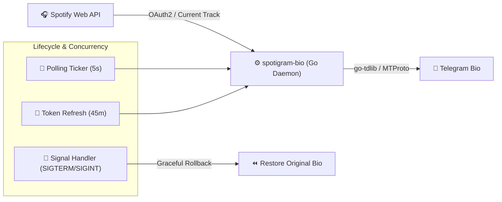

# 🎵 spotigram-bio

[](https://go.dev/)
[](https://core.telegram.org/tdlib)
[](https://developer.spotify.com/)
[](https://github.com/arseniizyk/spotigram-bio/actions/workflows/linter.yml)
[](./LICENSE)

**spotigram-bio** is a high-performance background daemon written in Go that automatically synchronizes your live Spotify playback status to your Telegram bio in real time, featuring native TDLib MTProto client integration and graceful state restoration.

---

## 🏛 System Architecture



---

## ✨ Key Features

- **⚡ Native TDLib Engine**: Communicates directly with Telegram's backend via the C++ `TDLib` library using native Go bindings (`go-tdlib`).
- **🛡️ Graceful Bio Restoration**: Saves your original Telegram bio on startup and automatically restores it upon termination (`Ctrl+C` or `SIGTERM`).
- **📲 QR-Code Authentication**: Easy one-time Telegram authorization — generates a QR code image to scan directly from mobile.
- **🔄 Automated Token Lifecycle**: Spotify OAuth2 tokens are stored locally and refreshed in a dedicated background goroutine every 45 minutes.
- **🐳 Docker Support**: Easily deployable via containerized multi-stage builds.

---

## ⚙️ Configuration

Create a `.env` file in the project root:

```env
TELEGRAM_APP_ID=1234567
TELEGRAM_APP_HASH=your_telegram_app_hash
SPOTIFY_CLIENT_ID=your_spotify_client_id
SPOTIFY_CLIENT_SECRET=your_spotify_client_secret
SPOTIFY_REDIRECT_URI=http://localhost:8888/callback
```

- Obtain Telegram App credentials from [my.telegram.org/apps](https://my.telegram.org/apps).
- Obtain Spotify credentials from [Spotify Developer Dashboard](https://developer.spotify.com/dashboard).

---

## 🚀 Getting Started

### Local Setup

Ensure `tdlib` dependencies are installed on your system:

```bash
# Clone the repository
git clone https://github.com/arseniizyk/spotigram-bio.git
cd spotigram-bio

# Install dependencies and run
go mod download
go run cmd/main.go
```

On first run:
1. Scan the generated QR code (`qr.png`) using the Telegram app (*Settings → Devices → Link Desktop Device*).
2. Follow the terminal prompt to authenticate with Spotify via the browser.

---

## 📄 License

This project is licensed under the MIT License — see the [LICENSE](./LICENSE) file for details.
